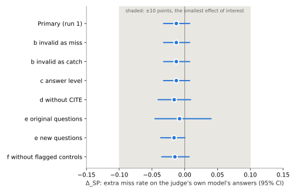
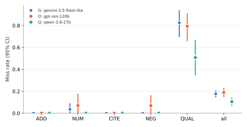

# Do LLM judges forgive errors in their own model's answers?

**Status: run-1 results. Runs 2 and 3 (run-to-run variation) are in progress.** Every number in the results section is generated by `analysis/run_analysis.py` from the raw replies in `runs/`.

Author: João Pedro Cardoso. The design, the pre-registration, the planted errors and the code were drafted with Claude (Anthropic); no Anthropic model is a generator or a judge in this study.

## 1. Question

When an LLM judges whether an answer is faithful to its source passages, does it miss a planted error more often in an answer written by its own model than in one written by another model? The pre-registered primary hypothesis (H1) and its decision rules are in [`docs/PREREGISTRATION.md`](docs/PREREGISTRATION.md), committed as `1749db0` and pushed before any model was called for this study.

## 2. Method (as run)

**Corpus and questions.** EU railway law as processed in `cardohso/rail-regulation-rag` at `96ccee4`. 40 questions were drafted (16 from the rail golden set, 24 new); **34 survived review** (section 4).

**Contexts.** Each question's context is its gold passage(s) plus the two highest-ranked non-gold passages by exact dense cosine similarity (BAAI/bge-small-en-v1.5), numbered by score. Generators and judges see the same context. `contexts/contexts.jsonl`, frozen before any answer was generated.

**Base answers.** One answer per question from each of two generators, temperature 0, the rail repo's generation prompt unchanged:
- A: `gemini-3.5-flash-lite` (Google), via the Gemini API;
- B: `gpt-oss-120b` (OpenAI), via Cerebras, `reasoning_effort: low`.

68 accepted base answers (34 per generator). Answers are never edited. All answers are rendered identically before anyone or anything sees them (whitespace and non-breaking hyphens normalised, section 4).

**Planted errors.** Each copy of a base answer has exactly one change, enforced by code: one sentence rewritten, or one sentence appended. Five types, 306 copies:

| Type | What changes | Copies |
|---|---|---|
| `ADD` | an appended sentence that no passage supports (the same sentence for both generators) | 68 |
| `NUM` | one number changed; 36 to another value in the cited passage, 21 to a value in no passage | 57 |
| `CITE` | one sentence's citation re-pointed to a passage that does not support it | 60 |
| `NEG` | a requirement negated or its direction reversed | 58 |
| `QUAL` | a modal weakened, or a condition or scope removed | 63 |

Plus 68 unperturbed controls. Types that did not apply to an answer are absent, so counts differ by type. Of the 57 `NUM` edits, 50 were written by hand and 7 by code (section 4). Rules that kept an edit from leaving the claim implied by the original: a lower bound only moves up, an upper bound only down.

**Judges.** One call per answer. The judge sees the passages, the question and the answer split into numbered sentences, and rates each sentence as supported or not against the passages it cites (prompt verbatim from pre-registration section 5.1). Temperature 0, JSON mode.

| Label | Model | Family | Host |
|---|---|---|---|
| G | `gemini-3.5-flash-lite` (same model as generator A) | Google | Gemini API |
| O | `gpt-oss-120b` (same model as generator B) | OpenAI | Cerebras |
| Q | `qwen-3.8-27b` (neutral reference) | Alibaba | Cerebras |

Three runs per judge and item, in a seeded random order per judge and run, run 1 complete for every judge before runs 2–3. Replies are cached by request and run number, so repeated runs are real calls. Free tiers only, with a daily request budget (Gemini 100, Cerebras 300 shared by O and Q); the runs were spread over days by a scheduled task.

**Statistics.** Primary estimate Δ_SP = ½[(m_G(A) − m_G(B)) + (m_O(B) − m_O(A))] on run 1, with a bootstrap over questions (10 000 resamples). Decision rules, secondary analyses S1–S9 and robustness variants are as pre-registered and are implemented in `src/judgebias/analysis.py` and `analysis/run_analysis.py`, tested on synthetic data with known answers.

## 3. Results (run 1)

All numbers below are generated by `analysis/run_analysis.py` from the raw replies in `runs/`; the full tables are in [`analysis/output/tables.md`](analysis/output/tables.md). Intervals are 95% bootstrap intervals over questions unless stated. Runs 2 and 3 are still in progress, so run-to-run variation (S4) and the majority-of-three-runs check (S8a) are not reported yet.

### 3.1 Primary hypothesis: no self-preference of 10 points or more

| Cell | Miss rate | Planted errors |
|---|---|---|
| Gemini judging Gemini's answers (own) | 0.17 | 155 |
| Gemini judging gpt-oss's answers | 0.18 | 151 |
| gpt-oss judging Gemini's answers | 0.20 | 155 |
| gpt-oss judging gpt-oss's answers (own) | 0.18 | 151 |

**Δ_SP = -0.01** (95% CI -0.03 to 0.01; 90% CI -0.03 to 0.00). The pooled miss rate is 0.18, above the 5% floor, so H1 was testable. The 90% interval lies inside ±0.10, so by pre-registered rule 4 the result is **no self-preference of 10 points or more**. Neither judge missed more errors in its own model's answers; the point estimate is slightly negative.

Every robustness variant that could be computed gives the same decision:

| Variant | Δ_SP | 95% CI |
|---|---|---|
| invalid replies counted as misses | -0.01 | -0.03 to 0.01 |
| invalid replies counted as catches | -0.01 | -0.03 to 0.01 |
| answer-level miss | -0.01 | -0.03 to 0.01 |
| without CITE errors | -0.02 | -0.04 to 0.01 |
| 16 original questions only | -0.01 | -0.05 to 0.04 |
| new questions only | -0.02 | -0.04 to 0.00 |
| without answers whose control the judge flagged | -0.02 | -0.04 to 0.01 |

The interval is narrower than the power simulation predicted (about ±0.02 instead of ±0.05), because the judges agree closely with each other (section 3.4), so most of the variation cancels in the paired comparison.

### 3.2 Which errors the judges miss

| Error type | Gemini | gpt-oss | Qwen |
|---|---|---|---|
| `ADD` unsupported sentence | 0.00 (0/68) | 0.00 (0/68) | 0.00 (0/67) |
| `NUM` changed number | 0.04 (2/57) | 0.07 (4/57) | 0.00 (0/57) |
| `CITE` wrong citation | 0.00 (0/60) | 0.00 (0/60) | 0.00 (0/60) |
| `NEG` reversed requirement | 0.00 (0/58) | 0.07 (4/58) | 0.00 (0/57) |
| `QUAL` weakened obligation or dropped condition | 0.83 (52/63) | 0.79 (50/63) | 0.51 (32/63) |
| all types | 0.18 (54/306) | 0.19 (58/306) | 0.11 (32/304) |

Almost every miss is a `QUAL` error: 52 of Gemini's 54 misses, 50 of gpt-oss's 58 and all 32 of Qwen's. The judges reliably caught added claims, wrong citations, and nearly all changed numbers and reversed requirements, but rated most sentences whose "must" became "should", or whose condition or scope was removed, as supported. Qwen missed these less often than the other two (51% against 83% and 79%). The changed numbers that were missed were all in-context values (another value from the cited passage); none of the out-of-context values was missed.

**How to read the `QUAL` result.** A miss there has two possible explanations, and this study cannot separate them: the judges may not check obligation strength and conditions, or some `QUAL` labels may be arguable (whether "should" misstates a "shall" is partly a legal judgement). All 306 labels were accepted by one reviewer with no rejections (deviation 3). An exploratory follow-up would be to have a second person re-label the missed `QUAL` items.

Because `QUAL` errors carry nearly all the misses, the primary test is in practice a test of self-preference on this one kind of error. By type (S6), Δ_SP is exactly 0 for `ADD` and `CITE` (no misses at all), 0.00 for `NUM` and 0.00 for `NEG` (few misses), and -0.06 for `QUAL` (95% CI -0.14 to 0.00): on the errors that judges do miss, they were if anything slightly less lenient on their own model's answers. These per-type estimates are exploratory.

### 3.3 False alarms on correct answers

| Judge | Controls flagged | Rate (95% CI) |
|---|---|---|
| Gemini | 2/68 | 0.03 (0.00 to 0.07) |
| gpt-oss | 0/68 | 0.00 (0.00 to 0.00) |
| Qwen | 4/67 | 0.06 (0.01 to 0.12) |

False alarms were rare. One Qwen control had no usable reply and is excluded. Low false alarms with high `QUAL` misses means the judges are lenient on that one kind of error, not strict everywhere.

### 3.4 Agreement between judges

Over all 580 sentence verdicts, Fleiss' κ was 0.89 (95% CI 0.86 to 0.92) and the judges agreed on 92% of sentences. On the 304 planted sentences alone κ was lower, 0.73 (0.63 to 0.82), largely because Qwen differed from the other two on `QUAL` errors (its κ with them was 0.71 and 0.65 on planted sentences, against 0.83 between Gemini and gpt-oss). Gemini and gpt-oss agreed most (κ 0.93 on all sentences).

### 3.5 Other comparisons (descriptive)

- **Against the neutral judge (S5).** Gemini's own-minus-other difference, minus Qwen's: 0.01 (-0.03 to 0.05). gpt-oss's: -0.04 (-0.07 to 0.00). gpt-oss was, if anything, slightly harsher on its own answers; the interval touches zero.
- **Generator difficulty (S9).** Qwen missed errors in Gemini's and gpt-oss's answers at about the same rate (difference -0.01, -0.05 to 0.02), so neither generator's errors were easier to spot.
- **Own versus other within a judge (S7, exact McNemar on matched pairs).** Gemini: missed on its own answers only 2 times and on gpt-oss's only 3 (p = 1.00 after Holm). gpt-oss: 1 against 5 (p = 0.44). Few discordant pairs, no difference.

### 3.6 What the data can and cannot support

- **Supported:** in this setup, neither Gemini 3.5 Flash-Lite nor gpt-oss-120b was more lenient on its own answers by 10 points or more. The 95% interval runs from 3 points in the opposite direction to 1 point of self-preference, so a self-preference larger than about 1 point lies outside the 95% interval for these two models on these errors.
- **Supported:** all three judges caught added claims and wrong citations essentially always, and missed most weakened obligations and dropped conditions.
- **Not supported:** any claim about self-preference in general, in other model families, for other judge prompts, in other domains, or for natural rather than planted errors.
- **Not supported:** that judges cannot detect obligation-strength errors in general. The `QUAL` labels rest on one reviewer, and the prompt did not name these error types (by design).
- **Pending:** run-to-run variation and the majority-of-three-runs robustness check (runs 2 and 3).

## 4. Deviations and clarifications

Dated, and made before any judge call unless stated.

1. **34 questions, not 40** (2026-11-02). Reviewing the base answers rejected 3 gpt-oss answers (q04: declared insufficient; n17: a factual sentence with no citation marker; q13: citations to passages that do not exist). While writing the planted errors I flagged three more accepted answers (n08 B: no marker; n01 B: wrong object of "decommissioning"; n06 B: a footnote value attributed to the wrong speed band), and the author rejected them. A rejected answer drops its question for both generators. The pre-registered minimum of 30 was met. Details: `answers/review_outcome.json`.
2. **Typography normalisation** (2026-11-02, clarification of section 5). gpt-oss writes U+202F and U+2011 characters (in 27 and 13 of its 40 answers) that Gemini never does, which could reveal the generator. All answers have non-breaking hyphens replaced by plain hyphens and whitespace normalised before judging (`src/judgebias/render.py`); the raw text is kept in `answers/answers.jsonl`.
3. **How the reviews were recorded.** The review sheets were blinded, but edits made in them did not reach the disk. The author's decisions were given in chat and recorded by Claude, with the boxes ticked on that instruction. The question review accepted all 24 new questions. The base-answer review accepted every answer except the three above; those three had been flagged by Claude beforehand, so blinding did not hold for them. **The planted-error review accepted all 306 items with no rejections, so no independent check of the labels beyond the author's acceptance and the code checks exists.**
4. **Who wrote the `NUM` edits.** The pre-registration assigned out-of-context `NUM` edits to code. For 14 of the 21 out-of-context edits (q07, n04, n09, n12, n13, n15, n19, both generators) a hand edit written by Claude was used instead, because goldpass's rule can move a lower bound down, which leaves the claim implied; every such value was checked by code to occur in no passage of its context. The other 7 (n05, n21, q09, q10) are goldpass's.
5. **An interim look.** After the first day of run 1 I (Claude) printed raw miss counts on the partial data (Gemini 5 of 53 planted errors, gpt-oss 34 of 201, Qwen 0 of 4) to check that the pipeline worked. The analysis plan, prompts and items were not changed in response. The analysis script has refused to compute estimates on partial data since.
6. **Budgets.** The Gemini daily budget started at 100 requests, a conservative guess because the real quota was not visible for a new key. After about 200 calls with no rate-limit error, the author raised it to 400 on 2026-11-03, during run 1. The budget only paces the calls; it does not change any request, so results are unaffected. Cerebras stayed at 300 a day, shared by judges O and Q.
7. **Two pipeline fixes during run 1** (2026-11-03; no prompt, item, model or setting changed). (a) The run script stopped every judge as soon as one provider's budget was used up, so on day 2 the Cerebras judges did not run; judges now continue independently. (b) A reply with no text, from a reasoning model that spent all 4 096 tokens thinking, aborted the run; it is now retried twice and then recorded as invalid, as section 5.2 requires. Neither fix touched a reply already received: the affected item had none.

## 5. Limitations

- One domain (EU railway law), English only, 34 questions. By the power simulation, effects of about 5 points or less cannot be detected reliably.
- One model per family: this tests same-*model* preference, the strongest form, not family-level preference.
- Free-tier models can change silently behind a stable id; call dates and response metadata are in `runs/`.
- One judge prompt. Results may not transfer to other prompts, including goldpass's claim-based faithfulness prompt.
- gpt-oss is a reasoning model and Gemini Flash-Lite is not; the crossed design removes judge-wide and generator-wide differences but not every interaction.
- The planted errors are hand-crafted, most by an LLM (Claude), and may not look like natural hallucinations. One human reviewer, who accepted them all (deviation 3).
- 44 of the 68 base answers are a single sentence, so for them the planted sentence is the whole answer, and "caught for the wrong reason" can only occur in the multi-sentence minority.
- If the pooled miss rate is below 5%, H1 is reported as not testable rather than as "no effect" (pre-registration section 8.3).

## 6. Relation to the CAPSI 2026 paper

The paper argues that non-deterministic generative pipelines need evaluation that accounts for run-to-run variation and evaluator bias, and names self-preference in LLM judges as one such bias. This study is a small, pre-registered test of that bias in one domain, with run-to-run variation measured and not assumed away. The earlier null result in `rail-regulation-rag` (lesson 7) could not detect self-preference because faithfulness was at its ceiling; the planted errors here exist to give the judges something to forgive.
